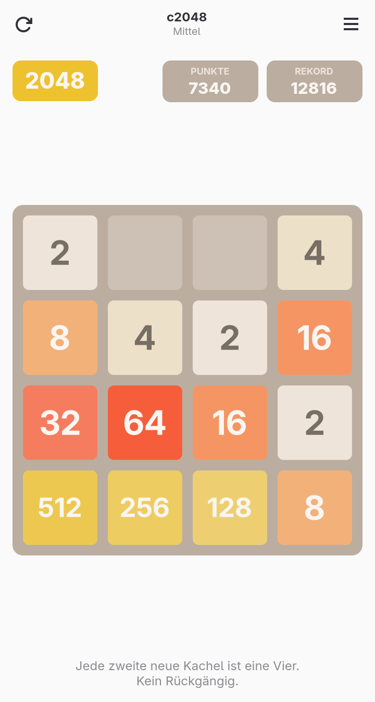
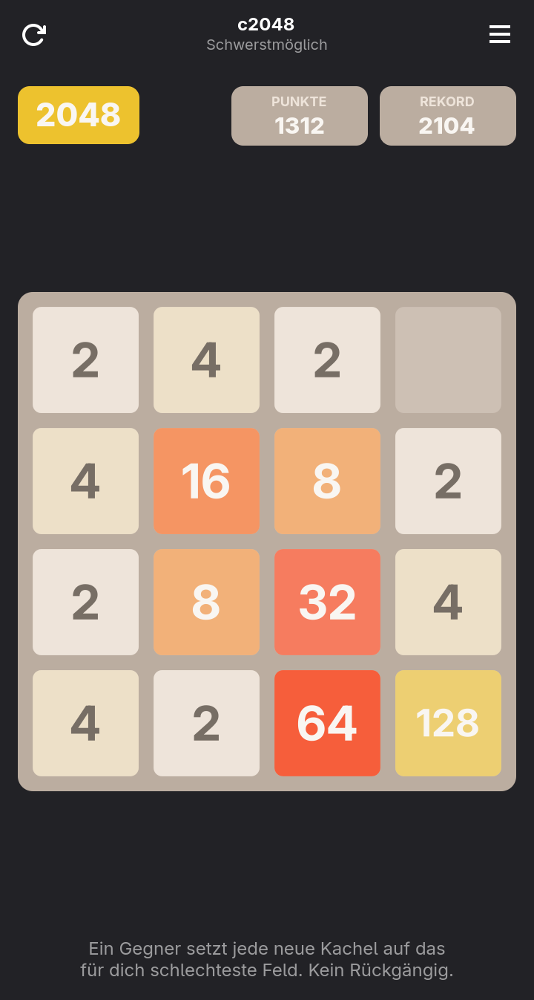

# c2048

The 2048 sliding puzzle as a native GTK4/libadwaita app, made for Linux
phones (Phosh, postmarketOS, Mobian, …) and desktops. Written in C, the board
is drawn with Cairo.

App ID: `io.github.ElTentakel.c2048` · License: MIT

<p align="center">
  
  
</p>

> The user interface is currently German only.

## Playing

Tiles with the same number merge when pushed into each other. Reach **2048**,
then keep going if you like.

| Action | Touch | Keyboard |
|---|---|---|
| Slide | swipe on the board (≥ 30 px) | arrow keys, WASD, hjkl |
| New game | ⟳ button or menu → *Neues Spiel* | Ctrl+N |
| Undo | ↶ button (*Leicht* only) | Ctrl+Z |
| Difficulty | menu ☰ top right | – |

## Difficulty levels

| Level (UI name) | Internal ID | New tiles | Undo |
|---|---|---|---|
| Easy (*Leicht*) | `easy` | only 2s, random cell | up to 100 moves |
| Medium (*Mittel*) | `hard` | 50 % 2s / 50 % 4s, random cell | none |
| Hardest possible (*Schwerstmöglich*) | `evil` | an opponent picks cell **and** value | none |

*Medium* has the ID `hard` for historical reasons: it was called "hard" before
the original classic level (90 % / 10 %) was removed.

Each level keeps its **own game and high score**. Switching saves the running
game and resumes it when you come back. The undo history lives in memory only.

### The opponent ("Schwerstmöglich")

After every move the opponent tries each empty cell with a 2 and a 4 and runs
a minimax search **two player moves deep** (player → opponent → player). It
picks the placement that leaves the player with the worst best case; ties are
broken randomly. It also places the two starting tiles.

Board evaluation (`heuristic()`): empty cells × 3.0, adjacent equal tiles
× 1.5, monotonicity of rows and columns (log₂ values) × 0.5 as a penalty;
no move left counts as −1,000,000. One placement takes about 1 ms on a
Snapdragon 845.

**Compared to the official rules:** in the original game by Gabriele Cirulli
a new tile appears on a *random* empty cell, a 2 with 90 % and a 4 with 10 %
probability. The opponent also places exactly one 2 or 4 on an empty cell, so
every position it creates is possible in the original. But cell and value are
chosen instead of drawn, and 4s are far more frequent than 10 %. That is the
point of this level.

### Simulation

Greedy bot (one move look-ahead, no undo), 200 games per level. "Classic" is
the removed level, kept for comparison.

| Level | Avg. score | Best tile |
|---|---|---|
| Easy | 16,137 | 2048 |
| *Classic (removed)* | 15,589 | 4096 |
| Medium | 11,464 | 2048 |
| Hardest possible | 826 | 256 |

## Save file

`$XDG_DATA_HOME/c2048/state.ini`, i.e. `~/.local/share/c2048/state.ini`
natively and `~/.var/app/io.github.ElTentakel.c2048/data/c2048/state.ini`
in the Flatpak. Written after every move.

```ini
[settings]
difficulty=hard            # last selected level

[hard]                     # one group per level: easy / hard / evil
grid=0;2;4;…               # 16 values, row by row, 0 = empty
score=1234
best=5678
keep_going=false           # "keep playing" chosen after reaching 2048
```

Without a saved level the app starts on *Medium*. A saved game with no move
left is not resumed. Saves of the pre-release name (`…/game2048/`) are moved
over on first start; obsolete groups (`[game]`, `[medium]`) are dropped.

## Building

Dependencies: meson ≥ 1.0, a C compiler, GTK ≥ 4.14, libadwaita ≥ 1.5.
Optional for `meson test`: `desktop-file-validate`, `appstreamcli`.

```sh
meson setup build
ninja -C build
meson test -C build      # validates .desktop and metainfo
./build/c2048
sudo meson install -C build
```

### Flatpak

```sh
flatpak install flathub org.gnome.Sdk//51 org.gnome.Platform//51
flatpak-builder --user --install --force-clean build-flatpak io.github.ElTentakel.c2048.yml
flatpak run io.github.ElTentakel.c2048
```

`io.github.ElTentakel.c2048.yml` builds the working tree. The manifest
submitted to Flathub uses a git source pinned to a release tag and commit.

### CI

`.github/workflows/flatpak.yml` builds the Flatpak for x86_64 and aarch64
on every push and pull request. Bundles are available as workflow artifacts;
for tags `v*` they are also attached to the GitHub release:

```sh
flatpak install --user c2048-aarch64.flatpak
```

## Releasing

1. Bump `version` in `meson.build`, add a `<release>` entry to
   `data/io.github.ElTentakel.c2048.metainfo.xml`.
2. If the UI changed: `tools/screenshots.sh` (needs a Wayland session) and
   update the screenshot URLs in the metainfo to the new tag.
3. `git tag v1.x.y && git push --tags`. CI attaches the Flatpak bundles to
   the release.
4. On Flathub: update `tag` and `commit` in the manifest of
   `flathub/io.github.ElTentakel.c2048`.

## Code layout

Everything lives in `src/main.c`:

| Section | Functions |
|---|---|
| Board logic (UI-free) | `slide()` (move/merge in one of 4 directions, returns animation data), `can_move()` |
| Opponent | `heuristic()`, `player_value()`, `adversary_value()`, `adversary_place()` |
| Persistence | `save_state()`, `load_state()`, `load_difficulty()` |
| Game flow | `spawn_tile()`, `do_move()`, `undo()`, `new_game()`, `set_difficulty()` |
| Drawing | `draw_board()`, `draw_tile()`; two animation phases on a tick callback: slide (110 ms), then pop-in of new / pulse of merged tiles (160 ms) |
| Input & actions | `on_key()`, `on_drag_end()`, window actions `win.new-game`, `win.undo`, `win.difficulty` (stateful, string) |
| UI | `activate()`: `AdwToolbarView` with header bar, score row, `GtkDrawingArea`, hint; `AdwClamp` (max. 560 px) |

Levels are defined in the `DIFFS[]` table (`id`, `name`, `desc`, `p4` =
probability of a 4 or < 0 for the opponent, `undo` = undo depth). A new level
needs one entry there and one in the `Diff` enum.

Other files:

| File | Purpose |
|---|---|
| `src/style.css`, `src/c2048.gresource.xml` | Styles, compiled into a GResource |
| `data/*.desktop`, `data/*.metainfo.xml` | Launcher and AppStream metadata |
| `data/icons/` | App icon |
| `data/screenshots/` | Store screenshots (referenced from the metainfo) |
| `tools/` | Screenshot generator, not part of the app |
| `io.github.ElTentakel.c2048.yml` | Flatpak manifest |
| `.github/workflows/flatpak.yml` | CI |
